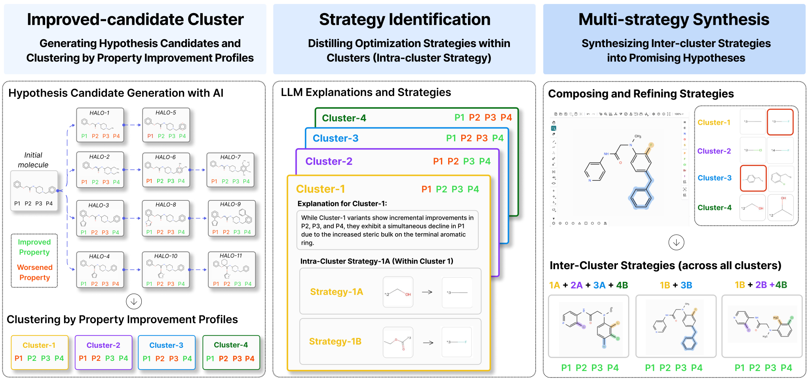

# HALO

**HALO: Interactive Co-abductive Reasoning in Hypothesis Generation for Scientific Discovery**

Youngseung Jeon, Kat Limqueco, JiaSyuan Chang, Xiang 'Anthony' Chen

[UIST 2026 paper](https://doi.org/10.1145/3830398.3830566) · [arXiv](https://arxiv.org/abs/2607.18564)


## Overview

Molecular lead optimization requires medicinal chemists to navigate a vast search space while balancing competing property objectives. Although generative models can propose novel molecular analogs, evaluating trade-offs and deciding which structural modifications to pursue remain challenging.

We introduce **HALO**, an interactive system that supports **human–AI co-abductive reasoning** in molecular hypothesis generation. HALO helps chemists (1) compare generated analogs across competing property objectives, (2) discover molecular editing strategies from recurring structural and property relationships, and (3) synthesize and refine these strategies into new molecular hypotheses.

In a study with 10 medicinal chemists, submitted molecules improved an average of 3.16 of four target properties with HALO, compared with 2.25 using a baseline with the same generative model. Improvements were evaluated using ADMET property predictions, and HALO submissions also exhibited lower pairwise structural similarity, indicating greater structural diversity. [Study methods and results](https://arxiv.org/html/2607.18564v2#S6)

[](https://arxiv.org/html/2607.18564v2)

This repository provides the Python backend for molecular design and research workflows. `halo.chem` provides local profiling, editing, drawing, and comparison. `HALOChem` connects to a service for analog generation, scientific evidence retrieval, and saved projects and decisions.

## Installation

Install [`uv`](https://docs.astral.sh/uv/getting-started/installation/), then install HALO from the repository root:

```bash
curl -LsSf https://astral.sh/uv/install.sh | sh
uv sync
```

`uv sync` creates the project environment and installs its dependencies. Local molecular calculations need no API credentials.

### API credentials

To run the agent workflows, create an [OpenAI API key](https://platform.openai.com/api-keys) and a [Supabase project](https://supabase.com/dashboard). Apply HALO's [database schema](tutorial/guide/04-context.md#set-up-the-database), then set the service credentials:

```bash
export OPENAI_API_KEY="your-openai-api-key"
export SUPABASE_URL="https://your-project.supabase.co"
export SUPABASE_PUBLISHABLE_KEY="your-supabase-publishable-key"
export SUPABASE_SECRET_KEY="your-supabase-secret-key"
```

The service also reads these settings from `.env`. Find the Supabase URL and keys in the [project dashboard](https://supabase.com/docs/guides/api/api-keys). Keep `SUPABASE_SECRET_KEY` on the server.

For direct Semantic Scholar searches, set its key and pass it as the `api_key` argument to `SemanticScholarClient`:

```bash
export SEMANTIC_SCHOLAR_API_KEY="your-semantic-scholar-api-key"
```

[Semantic Scholar API access](https://www.semanticscholar.org/product/api) · [Client example](tutorial/guide/05-reference.md#semanticscholarclient)

The default research workflow uses ChEMBL, PubChem, and Europe PMC without API keys. For a custom model endpoint, set `OPENAI_BASE_URL`. [Model configuration](tutorial/guide/02-models.md#configure-language-models)

### Start the service

```bash
uv run halo serve
```

Sign in as a Supabase Auth user in the same project, then export the returned `response.session.access_token` in the shell running your client:

```bash
export HALO_ACCESS_TOKEN="your-supabase-user-access-token"
```

[Supabase sign-in](https://supabase.com/docs/reference/python/auth-signinwithpassword)

## Quickstart

### Profile a molecule locally

Run Python with `uv run python`. Calculate a profile and inspect its molecular weight in g/mol:

```python
from halo import chem

profile = chem.profile_molecule("CCO")
print(f"{profile.descriptors.molecular_weight_g_mol:.2f} g/mol")
```

```text
46.07 g/mol
```

### Generate analogs in a project

With the service running and the user token exported, create a project and request changes from its lead:

```python
from os import environ

from halo import HALOChem

with HALOChem(
    base_url="http://localhost:8000",
    access_token=environ["HALO_ACCESS_TOKEN"],
) as halo:
    project = halo.projects.create(source_smiles="COc1ccc(F)cc1")
    run = project.generate_analogs(
        criteria={"solubility": "increase", "herg": "decrease"},
        n=4,
    )
    print(run)
```

The saved run shows verified candidates, prediction changes from the source, and individual goal outcomes. Continue with the [project tutorial](examples/basic-agent.md) to select a parent and retrieve papers and patents.

For command-line usage, start with `uv run halo --help` or the [CLI reference](tutorial/guide/05-reference.md#command-line).

## Documentation

1. [Overview](tutorial/guide/00-overview.md)
2. [Molecular tools](tutorial/guide/01-tools.md)
3. [Models and prediction](tutorial/guide/02-models.md)
4. [Agents and workflows](tutorial/guide/03-agents.md)
5. [Context and persistence](tutorial/guide/04-context.md)
6. [API and command-line reference](tutorial/guide/05-reference.md)

Start with the [project example](examples/basic-agent.md) for a complete generation and research workflow.

## Citation

```bibtex
@inproceedings{jeon2026halo,
  title={{HALO}: Interactive Co-abductive Reasoning in Hypothesis Generation for Scientific Discovery},
  author={Jeon, Youngseung and Limqueco, Kat and Chang, JiaSyuan and Chen, Xiang 'Anthony'},
  booktitle={Proceedings of the 39th Annual ACM Symposium on User Interface Software and Technology},
  pages={1--20},
  year={2026},
  doi={10.1145/3830398.3830566}
}
```

## License

[BSD-3-Clause](LICENSE)
