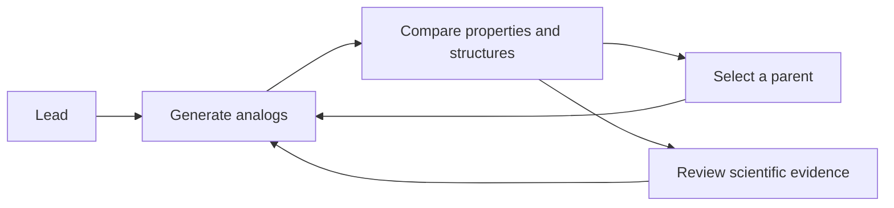

# Overview

Lead optimization compares structural changes against several property goals. A chemist might seek higher aqueous solubility while preserving another property, then use the results to choose the next analogs to investigate. HALO combines molecular calculations, property prediction, analog generation, and scientific evidence retrieval within this iterative process.

## Core concepts

| Concept | Meaning |
| --- | --- |
| Project | The lead and the molecules, results, and decisions saved while exploring its analogs. |
| Lead | The project's initial molecule. |
| Active parent | The molecule used to generate the next batch of analogs. A new session starts from the lead. |
| Run | A generated batch, linked to its source molecule and the predictions used to evaluate it. |
| Session | A conversation that records requests, responses, the active parent, and selected molecules. |

HALO identifies structures using canonical isomeric SMILES. Each run preserves its source and recorded predictions so later reviews can use the same baseline.

## Molecular results

The origin of a value determines how it can be compared.

| Kind | Example | Comparison requirements |
| --- | --- | --- |
| Calculated descriptor | RDKit molecular weight | Same quantity, unit, and method. |
| Predicted property | ADMET-AI aqueous solubility | Same endpoint, unit, and prediction method. |
| Experimental measurement | A saved assay result | Matching assay, endpoint, method, unit, and conditions. |

## Tutorial

### 1. Start with local chemistry

Use `halo.chem` to profile or edit structures without service credentials.

```python
from halo import chem

profile = chem.profile_molecule("COc1ccc(F)cc1")
print(profile.canonical_smiles)
```

```text
COc1ccc(F)cc1
```

The profile contains calculated descriptors and screening results. [Molecular tools](01-tools.md)

### 2. Add property predictions

Use a molecular predictor when comparing ADMET properties such as solubility or hERG inhibition. [Models and prediction](02-models.md)

### 3. Explore a saved project

Use `HALOChem` to generate analogs, inspect their results, and select a parent for another round. Project decisions remain available across sessions. Research lookups use the project lead by default; pass a molecule ID to investigate an analog. [Project tutorial](../../examples/basic-agent.md)



Continue with [agents and workflows](03-agents.md) for generation and selection, or [context and persistence](04-context.md) for evidence retrieval and saved decisions. Use the [API reference](05-reference.md) for signatures and parameters.
